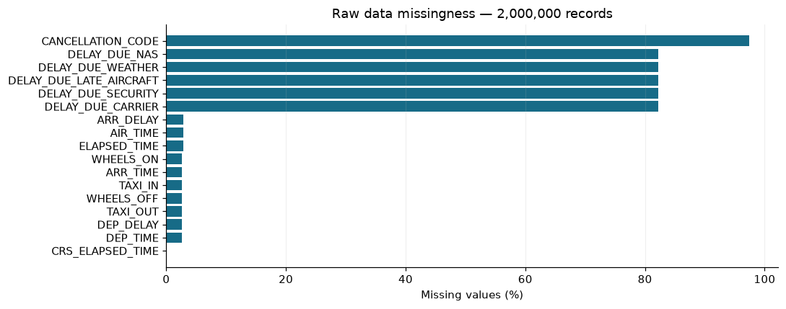
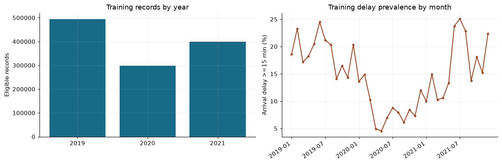
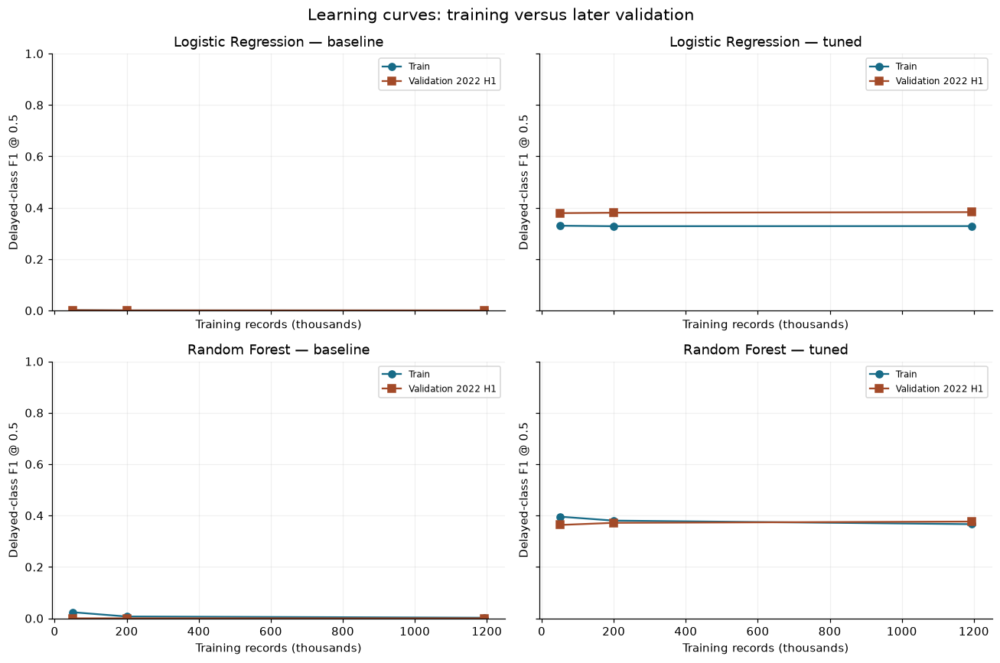
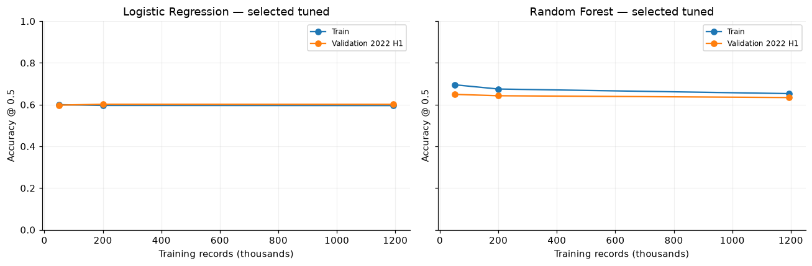
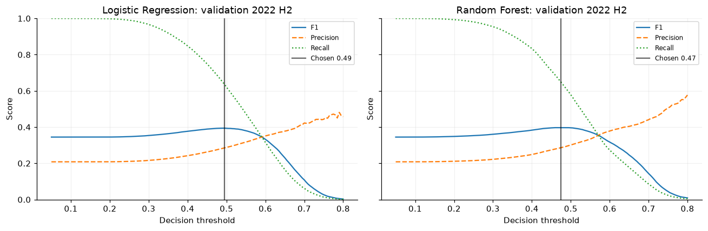
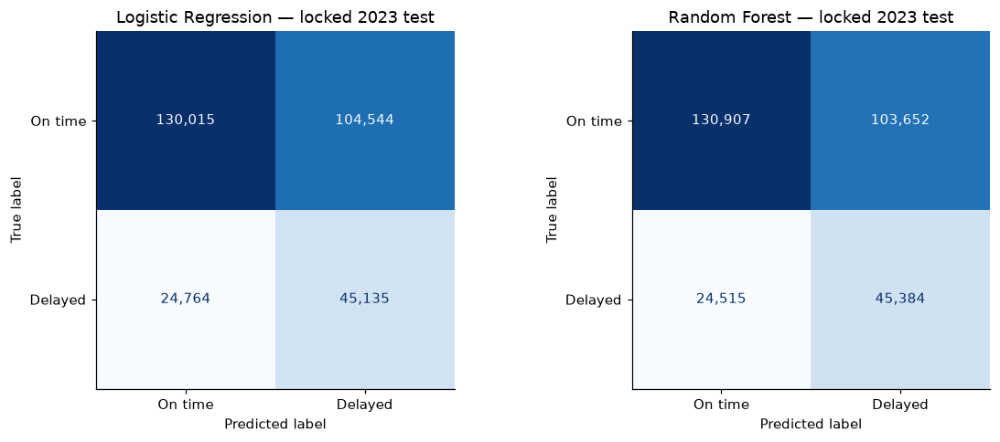
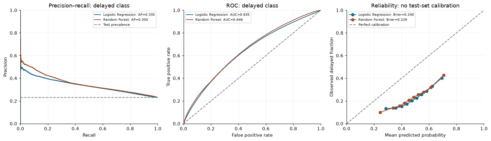
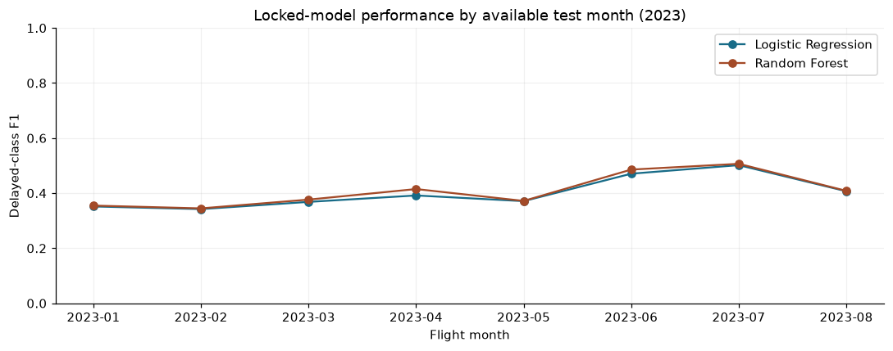

# รายงานผลการฝึก Logistic Regression และ Random Forest

**หน้านี้เป็นรายงานผลจริงที่เปิดอ่านบนหน้าแรกของ repo ได้ทันที** รวมการตรวจคุณภาพ/คลีนข้อมูล การจูน ผลก่อน–หลังปรับ learning curves การตรวจ overfit และผลทดสอบของทั้งสองโมเดล

รายงานส่งออกจาก outputs ที่บันทึกไว้ใน [notebook สำหรับ Run All](flight_delay_logistic_rf.ipynb) ไม่ได้ฝึกซ้ำ ไม่ได้จูนจาก test และไม่ได้สร้างคะแนนใหม่
โค้ดสำหรับรันทั้งหมดรวมอยู่ใน notebook ไฟล์เดียว; README และรูปใน `assets/` ใช้แสดงรายงานบน GitHub

## สรุปผลทดสอบ

เป้าหมายคือเที่ยวบินถึงช้าตั้งแต่ **15 นาทีขึ้นไป** ใช้ข้อมูลตารางบินที่ควรทราบล่วงหน้า ประเมินเฉพาะเที่ยวบินไม่ยกเลิก/ไม่ diverted ที่มี label ใช้ได้
ข้อมูลดิบ **2,000,000 แถว × 32 คอลัมน์** หลังคลีนและกำหนด cohort **1,942,769 แถว** ฝึกเต็ม **1,193,757 แถว** และ test ปี 2023 จำนวน **304,458 แถว**

ค่าที่เลือกใช้ **F1 ของเที่ยวบินล่าช้า** เป็นเกณฑ์พัฒนา โดยเลือก threshold ด้วย validation ก่อนเปิด test คะแนนทุกคอลัมน์ต่อไปนี้อยู่ในช่วง 0–1

| โมเดล | Threshold | Accuracy | Precision | Recall | F1 | AP | ROC-AUC |
|---|---:|---:|---:|---:|---:|---:|---:|
| Logistic Regression | 0.4950 | 0.5753 | 0.3015 | 0.6457 | 0.4111 | 0.3351 | 0.6347 |
| Random Forest | 0.4750 | 0.5790 | 0.3045 | 0.6493 | 0.4146 | 0.3504 | 0.6459 |


baseline@0.5 ได้ Accuracy ราว **77.04%** แต่แทบไม่ตรวจจับคลาสล่าช้า ค่าที่เลือกเพิ่ม Recall โดยแลก false positives และ Accuracy ที่ลดลง จึงไม่อ้างว่าค่าเหล่านี้เป็น Accuracy สูงสุดหรือพร้อมใช้งานจริง
ผล baseline และ selected ครบทั้งสองโมเดลอยู่ในหัวข้อผล test ด้านล่าง

## เปิดดูแต่ละส่วน

- [ข้อมูลและคุณภาพก่อนคลีน](#data-quality)
- [บันทึกการคลีนและการแบ่งชุด](#cleaning-and-split)
- [การจูนและพารามิเตอร์ครบทุก candidate](#tuning)
- [ผล train–validation ก่อนและหลังจูน](#development-results)
- [Learning curves](#learning-curves)
- [Overfit และผลการปรับ](#overfit)
- [Threshold ที่เลือกจาก validation](#threshold)
- [ผล test, classification reports และ confusion matrices](#test-results)
- [PR/ROC, calibration, ผลรายเดือนและเวลา](#diagnostics)
- [วิธีรันไฟล์เดียว](#run-all)

## พารามิเตอร์ที่เลือกจากการพัฒนา


### Logistic Regression

Variant: **tuned**; threshold: **0.4950**

```json
{
  "model__C": 0.03,
  "model__class_weight": "balanced"
}
```

### Random Forest

Variant: **tuned**; threshold: **0.4750**

```json
{
  "preprocess__cat__onehot__max_categories": 64,
  "model__n_estimators": 64,
  "model__min_samples_leaf": 50,
  "model__max_samples": 0.85,
  "model__max_features": 0.25,
  "model__max_depth": 20,
  "model__class_weight": "balanced_subsample"
}
```


## รายงานฉบับเต็มตามลำดับการรัน

ตารางและรูปต่อไปนี้มาจากผลรันที่แนบใน notebook โดยตรง บันทึกข้อความยาวระหว่าง fit ถูกพับไว้และกดขยายได้


## Context & Methods
**เป้าหมาย:** ทำนาย `ARR_DELAY >= 15` นาที (positive = เที่ยวบินล่าช้า) จากข้อมูลตารางบินที่ควรทราบก่อนออกเดินทาง
ใช้เฉพาะเที่ยวบินไม่ยกเลิก ไม่ diverted และมี label ที่ใช้ได้ ประเมินความเสี่ยงแบบมีเงื่อนไขในกลุ่มนี้ ไม่ใช่ทุกเที่ยวบินที่วางแผนไว้

### Key Assumptions
- การ์ดข้อมูลระบุ random sample 2 ล้านแถว 32 คอลัมน์จากปี 2019–สิงหาคม 2023; ตรวจจริงก่อนฝึก
- ไฟล์ย้อนหลังไม่มี schedule snapshot ณ T−120 นาที จึงเป็น retrospective schedule-only experiment ไม่ใช่หลักฐานระบบเตือนก่อนบินจริง
- ไม่ใช้ DEP_DELAY, เวลาเกิดจริง, สาเหตุ delay หรือ cancellation/diversion outcomes เป็น predictors
- ไม่มี TAIL_NUMBER และ weather forecast จึงไม่สมมติว่าทราบการหมุนเวียนลำเครื่องหรืออากาศจริง
- ห้ามใช้ปี 2023 จูน/เลือกโมเดล/threshold ปี 2019–2021 เป็น train; ปี 2022 เป็น validation แบ่งครึ่งปีสำหรับเลือก configuration และ threshold แยกกัน
- จูนแบบ forward-year CV ภายในตัวอย่างฝั่ง train เพื่อคุมเวลา จากนั้นฝึก baseline และ tuned ด้วย train เต็ม
- **จูน F1 ของคลาสล่าช้า** และแสดง Accuracy/Precision/Recall/F1 ครบ เพราะ Accuracy อย่างเดียวอาจได้สูงจากคลาสส่วนใหญ่
- เส้นทาง/สายการบินเดิมข้ามปีได้ตามโจทย์อนาคต ไม่ใช่การทดสอบสนามบินใหม่; ความต่างข้ามปีอาจรวม distribution shift

### 1. Setup และงบการทดลอง

<table border="1" class="dataframe">
  <thead>
    <tr style="text-align: right;">
      <th></th>
      <th>Run environment</th>
    </tr>
  </thead>
  <tbody>
    <tr>
      <th>Python</th>
      <td>3.12.10</td>
    </tr>
    <tr>
      <th>pandas</th>
      <td>2.3.3</td>
    </tr>
    <tr>
      <th>numpy</th>
      <td>2.3.5</td>
    </tr>
    <tr>
      <th>scipy</th>
      <td>1.16.3</td>
    </tr>
    <tr>
      <th>scikit-learn</th>
      <td>1.9.1</td>
    </tr>
    <tr>
      <th>matplotlib</th>
      <td>3.11.2</td>
    </tr>
    <tr>
      <th>CPU logical</th>
      <td>12</td>
    </tr>
    <tr>
      <th>threads/model</th>
      <td>4</td>
    </tr>
    <tr>
      <th>RAM total GB</th>
      <td>15.7800</td>
    </tr>
    <tr>
      <th>RAM available GB</th>
      <td>10.2300</td>
    </tr>
  </tbody>
</table>

<table border="1" class="dataframe">
  <thead>
    <tr style="text-align: right;">
      <th></th>
      <th>Plan</th>
    </tr>
  </thead>
  <tbody>
    <tr>
      <th>seed</th>
      <td>42</td>
    </tr>
    <tr>
      <th>dataset_version</th>
      <td>3</td>
    </tr>
    <tr>
      <th>tuning_row_budget</th>
      <td>180000</td>
    </tr>
    <tr>
      <th>RF_candidates</th>
      <td>8</td>
    </tr>
    <tr>
      <th>CV_train_years</th>
      <td>2019 -&gt; 2020; 2019–2020 -&gt; 2021</td>
    </tr>
    <tr>
      <th>main_train</th>
      <td>2019–2021</td>
    </tr>
    <tr>
      <th>validation_select</th>
      <td>2022 Jan–Jun</td>
    </tr>
    <tr>
      <th>validation_threshold</th>
      <td>2022 Jul–Dec</td>
    </tr>
    <tr>
      <th>test_locked</th>
      <td>2023 available dates</td>
    </tr>
  </tbody>
</table>

<a id="data-quality"></a>

## Data
### 2. อ่านข้อมูลต้นทางเข้า RAM และตรวจเวอร์ชัน
อ่าน 32 คอลัมน์เพื่อ audit ก่อนเลือก predictors ค่า missing ของหมวดหมู่ยังไม่ถูกเติมจากข้อมูลรวม
หากพบไฟล์ 10k/100k แทน 2m จะหยุดเพื่อป้องกันผลที่อ้างผิดขนาด

```text
Reading public Kaggle file into RAM; no disk extraction...
Received 93.2 MiB in memory
SOURCE: patrickzel/flight-delay-and-cancellation-data-2019-2023-v2/version3/flights_sample_2m.csv
Compressed source SHA256: a6efb5a66e1705e211e89a195ade4703acb2366985bf47a9a230b9cce27defab
Observed shape: (2000000, 32); DataFrame RAM: 311.0 MiB
```

<table border="1" class="dataframe">
  <thead>
    <tr style="text-align: right;">
      <th></th>
      <th>FL_DATE</th>
      <th>AIRLINE</th>
      <th>AIRLINE_DOT</th>
      <th>AIRLINE_CODE</th>
      <th>DOT_CODE</th>
      <th>FL_NUMBER</th>
      <th>ORIGIN</th>
      <th>ORIGIN_CITY</th>
      <th>DEST</th>
      <th>...</th>
      <th>CRS_ELAPSED_TIME</th>
      <th>ELAPSED_TIME</th>
      <th>AIR_TIME</th>
      <th>DISTANCE</th>
      <th>DELAY_DUE_CARRIER</th>
      <th>DELAY_DUE_WEATHER</th>
      <th>DELAY_DUE_NAS</th>
      <th>DELAY_DUE_SECURITY</th>
      <th>DELAY_DUE_LATE_AIRCRAFT</th>
    </tr>
  </thead>
  <tbody>
    <tr>
      <th>0</th>
      <td>2020-03-17</td>
      <td>United Air Lines Inc.</td>
      <td>United Air Lines Inc.: UA</td>
      <td>UA</td>
      <td>19,977.0000</td>
      <td>1,131.0000</td>
      <td>IAH</td>
      <td>Houston, TX</td>
      <td>MSY</td>
      <td>...</td>
      <td>76.0000</td>
      <td>63.0000</td>
      <td>46.0000</td>
      <td>305.0000</td>
      <td>NaN</td>
      <td>NaN</td>
      <td>NaN</td>
      <td>NaN</td>
      <td>NaN</td>
    </tr>
    <tr>
      <th>1</th>
      <td>2019-11-03</td>
      <td>Southwest Airlines Co.</td>
      <td>Southwest Airlines Co.: WN</td>
      <td>WN</td>
      <td>19,393.0000</td>
      <td>2,650.0000</td>
      <td>LAX</td>
      <td>Los Angeles, CA</td>
      <td>LAS</td>
      <td>...</td>
      <td>70.0000</td>
      <td>54.0000</td>
      <td>44.0000</td>
      <td>236.0000</td>
      <td>NaN</td>
      <td>NaN</td>
      <td>NaN</td>
      <td>NaN</td>
      <td>NaN</td>
    </tr>
    <tr>
      <th>2</th>
      <td>2020-04-02</td>
      <td>Southwest Airlines Co.</td>
      <td>Southwest Airlines Co.: WN</td>
      <td>WN</td>
      <td>19,393.0000</td>
      <td>3,263.0000</td>
      <td>OMA</td>
      <td>Omaha, NE</td>
      <td>STL</td>
      <td>...</td>
      <td>75.0000</td>
      <td>67.0000</td>
      <td>56.0000</td>
      <td>342.0000</td>
      <td>NaN</td>
      <td>NaN</td>
      <td>NaN</td>
      <td>NaN</td>
      <td>NaN</td>
    </tr>
    <tr>
      <th>3</th>
      <td>2022-09-03</td>
      <td>Envoy Air</td>
      <td>Envoy Air: MQ</td>
      <td>MQ</td>
      <td>20,398.0000</td>
      <td>3,936.0000</td>
      <td>ORD</td>
      <td>Chicago, IL</td>
      <td>CID</td>
      <td>...</td>
      <td>66.0000</td>
      <td>55.0000</td>
      <td>36.0000</td>
      <td>196.0000</td>
      <td>NaN</td>
      <td>NaN</td>
      <td>NaN</td>
      <td>NaN</td>
      <td>NaN</td>
    </tr>
    <tr>
      <th>4</th>
      <td>2021-05-04</td>
      <td>Delta Air Lines Inc.</td>
      <td>Delta Air Lines Inc.: DL</td>
      <td>DL</td>
      <td>19,790.0000</td>
      <td>1,614.0000</td>
      <td>LAS</td>
      <td>Las Vegas, NV</td>
      <td>SLC</td>
      <td>...</td>
      <td>85.0000</td>
      <td>77.0000</td>
      <td>56.0000</td>
      <td>368.0000</td>
      <td>NaN</td>
      <td>NaN</td>
      <td>NaN</td>
      <td>NaN</td>
      <td>NaN</td>
    </tr>
  </tbody>
</table>
<p>5 rows × 32 columns</p>

### 3. Audit ก่อนคลีน: missing, ชนิดข้อมูล, duplicate และช่วงค่า

```text
Exact duplicate rows: 0
```

<table border="1" class="dataframe">
  <thead>
    <tr style="text-align: right;">
      <th></th>
      <th>dtype</th>
      <th>missing_n</th>
      <th>missing_pct</th>
      <th>unique_n</th>
    </tr>
  </thead>
  <tbody>
    <tr>
      <th>CANCELLATION_CODE</th>
      <td>category</td>
      <td>1947478</td>
      <td>97.3739</td>
      <td>4</td>
    </tr>
    <tr>
      <th>DELAY_DUE_LATE_AIRCRAFT</th>
      <td>float32</td>
      <td>1643780</td>
      <td>82.1890</td>
      <td>866</td>
    </tr>
    <tr>
      <th>DELAY_DUE_CARRIER</th>
      <td>float32</td>
      <td>1643780</td>
      <td>82.1890</td>
      <td>1208</td>
    </tr>
    <tr>
      <th>DELAY_DUE_SECURITY</th>
      <td>float32</td>
      <td>1643780</td>
      <td>82.1890</td>
      <td>141</td>
    </tr>
    <tr>
      <th>DELAY_DUE_NAS</th>
      <td>float32</td>
      <td>1643780</td>
      <td>82.1890</td>
      <td>563</td>
    </tr>
    <tr>
      <th>DELAY_DUE_WEATHER</th>
      <td>float32</td>
      <td>1643780</td>
      <td>82.1890</td>
      <td>696</td>
    </tr>
    <tr>
      <th>ARR_DELAY</th>
      <td>float32</td>
      <td>57231</td>
      <td>2.8615</td>
      <td>1451</td>
    </tr>
    <tr>
      <th>ELAPSED_TIME</th>
      <td>float32</td>
      <td>57231</td>
      <td>2.8615</td>
      <td>693</td>
    </tr>
    <tr>
      <th>AIR_TIME</th>
      <td>float32</td>
      <td>57231</td>
      <td>2.8615</td>
      <td>662</td>
    </tr>
    <tr>
      <th>WHEELS_ON</th>
      <td>float32</td>
      <td>53091</td>
      <td>2.6545</td>
      <td>1440</td>
    </tr>
    <tr>
      <th>ARR_TIME</th>
      <td>float32</td>
      <td>53091</td>
      <td>2.6545</td>
      <td>1440</td>
    </tr>
    <tr>
      <th>TAXI_IN</th>
      <td>float32</td>
      <td>53091</td>
      <td>2.6545</td>
      <td>189</td>
    </tr>
    <tr>
      <th>WHEELS_OFF</th>
      <td>float32</td>
      <td>52281</td>
      <td>2.6141</td>
      <td>1440</td>
    </tr>
    <tr>
      <th>TAXI_OUT</th>
      <td>float32</td>
      <td>52281</td>
      <td>2.6141</td>
      <td>176</td>
    </tr>
    <tr>
      <th>DEP_DELAY</th>
      <td>float32</td>
      <td>51449</td>
      <td>2.5724</td>
      <td>1408</td>
    </tr>
    <tr>
      <th>DEP_TIME</th>
      <td>float32</td>
      <td>51430</td>
      <td>2.5715</td>
      <td>1440</td>
    </tr>
    <tr>
      <th>CRS_ELAPSED_TIME</th>
      <td>float32</td>
      <td>17</td>
      <td>0.0008</td>
      <td>640</td>
    </tr>
    <tr>
      <th>DEST_CITY</th>
      <td>category</td>
      <td>0</td>
      <td>0.0000</td>
      <td>373</td>
    </tr>
    <tr>
      <th>CRS_DEP_TIME</th>
      <td>float32</td>
      <td>0</td>
      <td>0.0000</td>
      <td>1387</td>
    </tr>
    <tr>
      <th>DEST</th>
      <td>category</td>
      <td>0</td>
      <td>0.0000</td>
      <td>380</td>
    </tr>
    <tr>
      <th>DOT_CODE</th>
      <td>float32</td>
      <td>0</td>
      <td>0.0000</td>
      <td>18</td>
    </tr>
    <tr>
      <th>FL_NUMBER</th>
      <td>float32</td>
      <td>0</td>
      <td>0.0000</td>
      <td>7087</td>
    </tr>
    <tr>
      <th>ORIGIN</th>
      <td>category</td>
      <td>0</td>
      <td>0.0000</td>
      <td>380</td>
    </tr>
    <tr>
      <th>ORIGIN_CITY</th>
      <td>category</td>
      <td>0</td>
      <td>0.0000</td>
      <td>373</td>
    </tr>
    <tr>
      <th>AIRLINE</th>
      <td>category</td>
      <td>0</td>
      <td>0.0000</td>
      <td>18</td>
    </tr>
    <tr>
      <th>AIRLINE_DOT</th>
      <td>category</td>
      <td>0</td>
      <td>0.0000</td>
      <td>18</td>
    </tr>
    <tr>
      <th>FL_DATE</th>
      <td>string</td>
      <td>0</td>
      <td>0.0000</td>
      <td>1704</td>
    </tr>
    <tr>
      <th>AIRLINE_CODE</th>
      <td>category</td>
      <td>0</td>
      <td>0.0000</td>
      <td>18</td>
    </tr>
    <tr>
      <th>DIVERTED</th>
      <td>float32</td>
      <td>0</td>
      <td>0.0000</td>
      <td>2</td>
    </tr>
    <tr>
      <th>CANCELLED</th>
      <td>float32</td>
      <td>0</td>
      <td>0.0000</td>
      <td>2</td>
    </tr>
    <tr>
      <th>CRS_ARR_TIME</th>
      <td>float32</td>
      <td>0</td>
      <td>0.0000</td>
      <td>1432</td>
    </tr>
    <tr>
      <th>DISTANCE</th>
      <td>float32</td>
      <td>0</td>
      <td>0.0000</td>
      <td>1720</td>
    </tr>
  </tbody>
</table>

<table border="1" class="dataframe">
  <thead>
    <tr style="text-align: right;">
      <th></th>
      <th>count</th>
      <th>mean</th>
      <th>std</th>
      <th>min</th>
      <th>1%</th>
      <th>50%</th>
      <th>99%</th>
      <th>max</th>
    </tr>
  </thead>
  <tbody>
    <tr>
      <th>DISTANCE</th>
      <td>2,000,000.0000</td>
      <td>809.7667</td>
      <td>588.6667</td>
      <td>29.0000</td>
      <td>100.0000</td>
      <td>651.0000</td>
      <td>2,588.0000</td>
      <td>5,095.0000</td>
    </tr>
    <tr>
      <th>CRS_ELAPSED_TIME</th>
      <td>1,999,983.0000</td>
      <td>142.3172</td>
      <td>71.6444</td>
      <td>-77.0000</td>
      <td>48.0000</td>
      <td>125.0000</td>
      <td>374.0000</td>
      <td>705.0000</td>
    </tr>
    <tr>
      <th>ARR_DELAY</th>
      <td>1,942,769.0000</td>
      <td>4.3020</td>
      <td>51.5845</td>
      <td>-119.0000</td>
      <td>-37.0000</td>
      <td>-7.0000</td>
      <td>190.0000</td>
      <td>3,237.0000</td>
    </tr>
    <tr>
      <th>CRS_DEP_TIME</th>
      <td>2,000,000.0000</td>
      <td>1,327.1642</td>
      <td>485.7418</td>
      <td>1.0000</td>
      <td>520.0000</td>
      <td>1,320.0000</td>
      <td>2,252.0000</td>
      <td>2,359.0000</td>
    </tr>
    <tr>
      <th>CRS_ARR_TIME</th>
      <td>2,000,000.0000</td>
      <td>1,490.4059</td>
      <td>511.6216</td>
      <td>1.0000</td>
      <td>36.0000</td>
      <td>1,516.0000</td>
      <td>2,351.0000</td>
      <td>2,400.0000</td>
    </tr>
  </tbody>
</table>



<a id="cleaning-and-split"></a>

### 4. คลีนแบบตรวจสอบจำนวนได้
ลบ exact duplicates, วันที่เสีย/อยู่นอกช่วง, flags ที่ไม่ทราบ outcome และรายการไม่เข้าเงื่อนไข label
แถวที่มี flight key ซ้ำแต่ต่างรายละเอียดจะแยกออกทั้งหมดเพื่อไม่เลือกเวอร์ชันย้อนหลังตามใจ
ค่าระยะทาง/ระยะเวลาตารางที่ใช้ไม่ได้จะเปลี่ยนเป็น missing แล้วให้ imputer เรียนจาก train เท่านั้น
**ไม่ตัด ARR_DELAY สูงด้วย IQR/percentile:** ความล่าช้าสูงอาจเป็นเหตุการณ์จริง

```text
Before: 2,000,000; after: 1,942,769; excluded: 57,231
Actual eligible coverage: 2019-01-01 00:00:00 to 2023-08-31 00:00:00
```

<table border="1" class="dataframe">
  <thead>
    <tr style="text-align: right;">
      <th></th>
      <th>step</th>
      <th>before_n</th>
      <th>removed_n</th>
      <th>after_n</th>
    </tr>
  </thead>
  <tbody>
    <tr>
      <th>0</th>
      <td>Remove exact duplicate rows</td>
      <td>2000000</td>
      <td>0</td>
      <td>2000000</td>
    </tr>
    <tr>
      <th>1</th>
      <td>Invalid flight date</td>
      <td>2000000</td>
      <td>0</td>
      <td>2000000</td>
    </tr>
    <tr>
      <th>2</th>
      <td>Outside declared 2019–2023 coverage</td>
      <td>2000000</td>
      <td>0</td>
      <td>2000000</td>
    </tr>
    <tr>
      <th>3</th>
      <td>Unknown/invalid cancellation or diversion status</td>
      <td>2000000</td>
      <td>0</td>
      <td>2000000</td>
    </tr>
    <tr>
      <th>4</th>
      <td>Cancelled flights — outside target cohort</td>
      <td>2000000</td>
      <td>52522</td>
      <td>1947478</td>
    </tr>
    <tr>
      <th>5</th>
      <td>Diverted flights — outside target cohort</td>
      <td>1947478</td>
      <td>4709</td>
      <td>1942769</td>
    </tr>
    <tr>
      <th>6</th>
      <td>Missing/nonfinite arrival-delay label</td>
      <td>1942769</td>
      <td>0</td>
      <td>1942769</td>
    </tr>
    <tr>
      <th>7</th>
      <td>Missing route endpoints</td>
      <td>1942769</td>
      <td>0</td>
      <td>1942769</td>
    </tr>
    <tr>
      <th>8</th>
      <td>Ambiguous repeated event keys; exclude all unr...</td>
      <td>1942769</td>
      <td>0</td>
      <td>1942769</td>
    </tr>
  </tbody>
</table>

<table border="1" class="dataframe">
  <thead>
    <tr style="text-align: right;">
      <th></th>
      <th>column</th>
      <th>invalid_or_missing_n</th>
      <th>action</th>
    </tr>
  </thead>
  <tbody>
    <tr>
      <th>0</th>
      <td>DISTANCE</td>
      <td>0</td>
      <td>Set NaN; train-only median imputation</td>
    </tr>
    <tr>
      <th>1</th>
      <td>CRS_ELAPSED_TIME</td>
      <td>1</td>
      <td>Set NaN; train-only median imputation</td>
    </tr>
    <tr>
      <th>2</th>
      <td>CRS_DEP_TIME</td>
      <td>0</td>
      <td>Set NaN; 2400 maps to clock midnight only</td>
    </tr>
    <tr>
      <th>3</th>
      <td>CRS_ARR_TIME</td>
      <td>0</td>
      <td>Set NaN; 2400 maps to clock midnight only</td>
    </tr>
  </tbody>
</table>

<table border="1" class="dataframe">
  <thead>
    <tr style="text-align: right;">
      <th></th>
      <th>flight_date</th>
      <th>ORIGIN</th>
      <th>DEST</th>
      <th>CRS_DEP_TIME</th>
      <th>DISTANCE</th>
      <th>ARR_DELAY</th>
      <th>delayed</th>
    </tr>
  </thead>
  <tbody>
    <tr>
      <th>0</th>
      <td>2019-01-01</td>
      <td>PHX</td>
      <td>ANC</td>
      <td>15.0000</td>
      <td>2,552.0000</td>
      <td>-10.0000</td>
      <td>0</td>
    </tr>
    <tr>
      <th>1</th>
      <td>2019-01-01</td>
      <td>SFO</td>
      <td>IAH</td>
      <td>50.0000</td>
      <td>1,635.0000</td>
      <td>-1.0000</td>
      <td>0</td>
    </tr>
    <tr>
      <th>2</th>
      <td>2019-01-01</td>
      <td>LAS</td>
      <td>CLT</td>
      <td>107.0000</td>
      <td>1,916.0000</td>
      <td>0.0000</td>
      <td>0</td>
    </tr>
    <tr>
      <th>3</th>
      <td>2019-01-01</td>
      <td>PSE</td>
      <td>MCO</td>
      <td>435.0000</td>
      <td>1,179.0000</td>
      <td>-22.0000</td>
      <td>0</td>
    </tr>
    <tr>
      <th>4</th>
      <td>2019-01-01</td>
      <td>BOS</td>
      <td>MYR</td>
      <td>505.0000</td>
      <td>738.0000</td>
      <td>-16.0000</td>
      <td>0</td>
    </tr>
  </tbody>
</table>

### 5. ฟีเจอร์ deterministic และชุดข้อมูลตามเวลา
จำนวนคอลัมน์ดิบไม่เท่ากับจำนวน predictors ที่ใช้ได้ก่อนบิน สร้าง calendar/route/clock features จากข้อมูลตามตารางเท่านั้น
`2400` เปลี่ยนเป็นมุมเวลาเที่ยงคืนเพื่อสร้าง sin/cos ไม่ใช้อนุมาน UTC หรือวันมาถึง
ไม่ดูคะแนน test ในขั้นพัฒนา ตารางขนาดแสดงเฉพาะจำนวนและช่วงวันที่; prevalence ของ test แสดงตอนประเมินสุดท้าย

```text
Predictors: ['airline', 'flight_number', 'origin', 'destination', 'route', 'month', 'weekday', 'departure_sin', 'departure_cos', 'arrival_sin', 'arrival_cos', 'distance', 'scheduled_duration']
Full schema fields: 32 | engineered predictors: 13
```

<table border="1" class="dataframe">
  <thead>
    <tr style="text-align: right;">
      <th></th>
      <th>split</th>
      <th>rows</th>
      <th>share_pct</th>
      <th>from</th>
      <th>to</th>
    </tr>
  </thead>
  <tbody>
    <tr>
      <th>0</th>
      <td>Train</td>
      <td>1193757</td>
      <td>61.4462</td>
      <td>2019-01-01</td>
      <td>2021-12-31</td>
    </tr>
    <tr>
      <th>1</th>
      <td>Validation: select</td>
      <td>217402</td>
      <td>11.1903</td>
      <td>2022-01-01</td>
      <td>2022-06-30</td>
    </tr>
    <tr>
      <th>2</th>
      <td>Validation: threshold</td>
      <td>227152</td>
      <td>11.6922</td>
      <td>2022-07-01</td>
      <td>2022-12-31</td>
    </tr>
    <tr>
      <th>3</th>
      <td>Test: locked</td>
      <td>304458</td>
      <td>15.6713</td>
      <td>2023-01-01</td>
      <td>2023-08-31</td>
    </tr>
  </tbody>
</table>

<table border="1" class="dataframe">
  <thead>
    <tr style="text-align: right;">
      <th></th>
      <th>split</th>
      <th>delayed_n</th>
      <th>delayed_rate</th>
    </tr>
  </thead>
  <tbody>
    <tr>
      <th>0</th>
      <td>Train</td>
      <td>192860</td>
      <td>0.1616</td>
    </tr>
    <tr>
      <th>1</th>
      <td>Validation: select</td>
      <td>46122</td>
      <td>0.2122</td>
    </tr>
    <tr>
      <th>2</th>
      <td>Validation: threshold</td>
      <td>47339</td>
      <td>0.2084</td>
    </tr>
  </tbody>
</table>

### 6. EDA เฉพาะ train: ขนาดรายปีและอัตราล่าช้ารายเดือน



## Results
### 7. Pipeline, metrics และเครื่องมือวัด
one-hot จัดกลุ่ม rare categories จาก **train ในแต่ละ fit เท่านั้น** เพื่อคุม RAM: baseline จำกัด 128 categories ต่อฟีเจอร์
ไม่สร้าง target encoding จากข้อมูลรวม Numeric scaler ใช้กับ Logistic เท่านั้น Random Forest ไม่ต้อง scale
เก็บโมเดลและผล intermediate ใน RAM ไม่มี `joblib.dump`, `to_csv` หรือ `savefig`

<table border="1" class="dataframe">
  <thead>
    <tr style="text-align: right;">
      <th></th>
      <th>fold</th>
      <th>train_n</th>
      <th>validation_n</th>
      <th>train_end</th>
      <th>validation_start</th>
      <th>validation_end</th>
    </tr>
  </thead>
  <tbody>
    <tr>
      <th>0</th>
      <td>1</td>
      <td>74467</td>
      <td>45199</td>
      <td>2019-12-31</td>
      <td>2020-01-01</td>
      <td>2020-12-31</td>
    </tr>
    <tr>
      <th>1</th>
      <td>2</td>
      <td>119666</td>
      <td>60334</td>
      <td>2020-12-31</td>
      <td>2021-01-01</td>
      <td>2021-12-31</td>
    </tr>
  </tbody>
</table>

<a id="tuning"></a>

### 8. จูนจาก forward-year CV ภายใน train
ค้น 8 configurations ต่อโมเดล (2 chronological folds ต่อ configuration) เทียบ F1@0.5 เป็นหลักและบันทึก Accuracy/AP ด้วย
Logistic: C และ class weight; RF: depth, leaf size, feature sampling, row sampling, tree count และ rare-category cap
CV เป็นการคัดกรองด้วยตัวอย่างที่สุ่มเฉพาะฝั่ง train แล้วคงลำดับปี ไม่ใช่การลดขนาดชุดฝึกสุดท้าย

<details>
<summary>แสดงบันทึกการฝึกทุก fold และทุก candidate</summary>

```text
Searching Logistic Regression
Logistic Regression search 1/8 fold 1: 74,467 train rows; fit 0.6s
Logistic Regression search 1/8 fold 2: 119,666 train rows; fit 0.9s
  candidate 1: CV F1=0.0013, Accuracy=0.8642
Logistic Regression search 2/8 fold 1: 74,467 train rows; fit 0.6s
Logistic Regression search 2/8 fold 2: 119,666 train rows; fit 1.0s
  candidate 2: CV F1=0.2628, Accuracy=0.5908
Logistic Regression search 3/8 fold 1: 74,467 train rows; fit 0.6s
Logistic Regression search 3/8 fold 2: 119,666 train rows; fit 1.1s
  candidate 3: CV F1=0.0032, Accuracy=0.8640
Logistic Regression search 4/8 fold 1: 74,467 train rows; fit 0.7s
Logistic Regression search 4/8 fold 2: 119,666 train rows; fit 1.4s
  candidate 4: CV F1=0.2615, Accuracy=0.5899
Logistic Regression search 5/8 fold 1: 74,467 train rows; fit 0.7s
Logistic Regression search 5/8 fold 2: 119,666 train rows; fit 1.3s
  candidate 5: CV F1=0.0063, Accuracy=0.8639
Logistic Regression search 6/8 fold 1: 74,467 train rows; fit 0.8s
Logistic Regression search 6/8 fold 2: 119,666 train rows; fit 1.6s
  candidate 6: CV F1=0.2606, Accuracy=0.5884
Logistic Regression search 7/8 fold 1: 74,467 train rows; fit 0.9s
Logistic Regression search 7/8 fold 2: 119,666 train rows; fit 1.4s
  candidate 7: CV F1=0.0074, Accuracy=0.8638
Logistic Regression search 8/8 fold 1: 74,467 train rows; fit 0.9s
Logistic Regression search 8/8 fold 2: 119,666 train rows; fit 1.6s
  candidate 8: CV F1=0.2603, Accuracy=0.5878
CV-selected parameters: {'model__C': 0.03, 'model__class_weight': 'balanced'}

Searching Random Forest
Random Forest search 1/8 fold 1: 74,467 train rows; fit 6.6s
Random Forest search 1/8 fold 2: 119,666 train rows; fit 13.4s
  candidate 1: CV F1=0.2649, Accuracy=0.6240
Random Forest search 2/8 fold 1: 74,467 train rows; fit 1.4s
Random Forest search 2/8 fold 2: 119,666 train rows; fit 2.3s
  candidate 2: CV F1=0.0000, Accuracy=0.8644
Random Forest search 3/8 fold 1: 74,467 train rows; fit 5.4s
Random Forest search 3/8 fold 2: 119,666 train rows; fit 9.7s
  candidate 3: CV F1=0.0006, Accuracy=0.8643
Random Forest search 4/8 fold 1: 74,467 train rows; fit 1.5s
Random Forest search 4/8 fold 2: 119,666 train rows; fit 2.4s
  candidate 4: CV F1=0.0000, Accuracy=0.8644
Random Forest search 5/8 fold 1: 74,467 train rows; fit 1.7s
Random Forest search 5/8 fold 2: 119,666 train rows; fit 3.4s
  candidate 5: CV F1=0.2630, Accuracy=0.5763
Random Forest search 6/8 fold 1: 74,467 train rows; fit 2.3s
Random Forest search 6/8 fold 2: 119,666 train rows; fit 4.2s
  candidate 6: CV F1=0.2632, Accuracy=0.5624
Random Forest search 7/8 fold 1: 74,467 train rows; fit 7.8s
Random Forest search 7/8 fold 2: 119,666 train rows; fit 15.2s
  candidate 7: CV F1=0.2644, Accuracy=0.6239
Random Forest search 8/8 fold 1: 74,467 train rows; fit 1.2s
Random Forest search 8/8 fold 2: 119,666 train rows; fit 2.4s
  candidate 8: CV F1=0.0000, Accuracy=0.8644
CV-selected parameters: {'preprocess__cat__onehot__max_categories': 64, 'model__n_estimators': 64, 'model__min_samples_leaf': 50, 'model__max_samples': 0.85, 'model__max_features': 0.25, 'model__max_depth': 20, 'model__class_weight': 'balanced_subsample'}
F1 is the tuning objective. Highest Accuracy candidate may be different; no global optimum is claimed.
```

</details>

<table border="1" class="dataframe">
  <thead>
    <tr style="text-align: right;">
      <th></th>
      <th>model</th>
      <th>candidate</th>
      <th>CV_F1_mean</th>
      <th>CV_F1_std</th>
      <th>CV_Accuracy_mean</th>
      <th>CV_AP_mean</th>
      <th>parameters</th>
    </tr>
  </thead>
  <tbody>
    <tr>
      <th>0</th>
      <td>Logistic Regression</td>
      <td>2</td>
      <td>0.2628</td>
      <td>0.0633</td>
      <td>0.5908</td>
      <td>0.1868</td>
      <td>{'model__C': 0.03, 'model__class_weight': 'bal...</td>
    </tr>
    <tr>
      <th>1</th>
      <td>Logistic Regression</td>
      <td>4</td>
      <td>0.2615</td>
      <td>0.0634</td>
      <td>0.5899</td>
      <td>0.1859</td>
      <td>{'model__C': 0.15, 'model__class_weight': 'bal...</td>
    </tr>
    <tr>
      <th>2</th>
      <td>Logistic Regression</td>
      <td>6</td>
      <td>0.2606</td>
      <td>0.0622</td>
      <td>0.5884</td>
      <td>0.1850</td>
      <td>{'model__C': 1.0, 'model__class_weight': 'bala...</td>
    </tr>
    <tr>
      <th>3</th>
      <td>Logistic Regression</td>
      <td>8</td>
      <td>0.2603</td>
      <td>0.0624</td>
      <td>0.5878</td>
      <td>0.1847</td>
      <td>{'model__C': 5.0, 'model__class_weight': 'bala...</td>
    </tr>
    <tr>
      <th>4</th>
      <td>Logistic Regression</td>
      <td>7</td>
      <td>0.0074</td>
      <td>0.0051</td>
      <td>0.8638</td>
      <td>0.1858</td>
      <td>{'model__C': 5.0, 'model__class_weight': None}</td>
    </tr>
    <tr>
      <th>5</th>
      <td>Logistic Regression</td>
      <td>5</td>
      <td>0.0063</td>
      <td>0.0044</td>
      <td>0.8639</td>
      <td>0.1861</td>
      <td>{'model__C': 1.0, 'model__class_weight': None}</td>
    </tr>
    <tr>
      <th>6</th>
      <td>Logistic Regression</td>
      <td>3</td>
      <td>0.0032</td>
      <td>0.0022</td>
      <td>0.8640</td>
      <td>0.1872</td>
      <td>{'model__C': 0.15, 'model__class_weight': None}</td>
    </tr>
    <tr>
      <th>7</th>
      <td>Logistic Regression</td>
      <td>1</td>
      <td>0.0013</td>
      <td>0.0009</td>
      <td>0.8642</td>
      <td>0.1881</td>
      <td>{'model__C': 0.03, 'model__class_weight': None}</td>
    </tr>
    <tr>
      <th>8</th>
      <td>Random Forest</td>
      <td>1</td>
      <td>0.2649</td>
      <td>0.0668</td>
      <td>0.6240</td>
      <td>0.1932</td>
      <td>{'preprocess__cat__onehot__max_categories': 64...</td>
    </tr>
    <tr>
      <th>9</th>
      <td>Random Forest</td>
      <td>7</td>
      <td>0.2644</td>
      <td>0.0664</td>
      <td>0.6239</td>
      <td>0.1940</td>
      <td>{'preprocess__cat__onehot__max_categories': 64...</td>
    </tr>
    <tr>
      <th>10</th>
      <td>Random Forest</td>
      <td>6</td>
      <td>0.2632</td>
      <td>0.0693</td>
      <td>0.5624</td>
      <td>0.1919</td>
      <td>{'preprocess__cat__onehot__max_categories': 12...</td>
    </tr>
    <tr>
      <th>11</th>
      <td>Random Forest</td>
      <td>5</td>
      <td>0.2630</td>
      <td>0.0693</td>
      <td>0.5763</td>
      <td>0.1926</td>
      <td>{'preprocess__cat__onehot__max_categories': 64...</td>
    </tr>
    <tr>
      <th>12</th>
      <td>Random Forest</td>
      <td>3</td>
      <td>0.0006</td>
      <td>0.0003</td>
      <td>0.8643</td>
      <td>0.1933</td>
      <td>{'preprocess__cat__onehot__max_categories': 64...</td>
    </tr>
    <tr>
      <th>13</th>
      <td>Random Forest</td>
      <td>2</td>
      <td>0.0000</td>
      <td>0.0000</td>
      <td>0.8644</td>
      <td>0.1938</td>
      <td>{'preprocess__cat__onehot__max_categories': 12...</td>
    </tr>
    <tr>
      <th>14</th>
      <td>Random Forest</td>
      <td>4</td>
      <td>0.0000</td>
      <td>0.0000</td>
      <td>0.8644</td>
      <td>0.1912</td>
      <td>{'preprocess__cat__onehot__max_categories': 64...</td>
    </tr>
    <tr>
      <th>15</th>
      <td>Random Forest</td>
      <td>8</td>
      <td>0.0000</td>
      <td>0.0000</td>
      <td>0.8644</td>
      <td>0.1930</td>
      <td>{'preprocess__cat__onehot__max_categories': 64...</td>
    </tr>
  </tbody>
</table>

<a id="development-results"></a>

### 9. ฝึก baseline และ tuned ด้วย train เต็ม แล้วตรวจ validation ครึ่งแรก
ทุก configuration ฝึกด้วยแถวที่เข้าเงื่อนไขทั้งหมดของ 2019–2021 เลือก baseline/tuned ด้วย F1 ของ validation Jan–Jun 2022
คะแนน train ใช้ดูช่องว่าง ไม่ใช่ผลประเมินทั่วไป และช่องว่างอาจมีทั้ง overfit กับความต่างข้ามปี

```text
Logistic Regression baseline FULL TRAIN: 1,193,757 train rows; fit 14.1s
Logistic Regression baseline: encoded features=556
Logistic Regression tuned FULL TRAIN: 1,193,757 train rows; fit 15.2s
Logistic Regression tuned: encoded features=556
Random Forest baseline FULL TRAIN: 1,193,757 train rows; fit 342.2s
Random Forest baseline: encoded features=556
Random Forest tuned FULL TRAIN: 1,193,757 train rows; fit 450.4s
Random Forest tuned: encoded features=300
```

<table border="1" class="dataframe">
  <thead>
    <tr style="text-align: right;">
      <th></th>
      <th>model</th>
      <th>variant</th>
      <th>split</th>
      <th>threshold</th>
      <th>Accuracy</th>
      <th>Precision</th>
      <th>Recall</th>
      <th>F1</th>
      <th>AP</th>
      <th>ROC_AUC</th>
      <th>Brier</th>
    </tr>
  </thead>
  <tbody>
    <tr>
      <th>0</th>
      <td>Logistic Regression</td>
      <td>baseline</td>
      <td>train</td>
      <td>0.5000</td>
      <td>0.8384</td>
      <td>0.4795</td>
      <td>0.0002</td>
      <td>0.0004</td>
      <td>0.2549</td>
      <td>0.6415</td>
      <td>0.1305</td>
    </tr>
    <tr>
      <th>1</th>
      <td>Logistic Regression</td>
      <td>baseline</td>
      <td>validation_select</td>
      <td>0.5000</td>
      <td>0.7879</td>
      <td>0.6667</td>
      <td>0.0003</td>
      <td>0.0005</td>
      <td>0.3077</td>
      <td>0.6292</td>
      <td>0.1639</td>
    </tr>
    <tr>
      <th>2</th>
      <td>Logistic Regression</td>
      <td>tuned</td>
      <td>train</td>
      <td>0.5000</td>
      <td>0.5956</td>
      <td>0.2246</td>
      <td>0.6130</td>
      <td>0.3288</td>
      <td>0.2526</td>
      <td>0.6417</td>
      <td>0.2349</td>
    </tr>
    <tr>
      <th>3</th>
      <td>Logistic Regression</td>
      <td>tuned</td>
      <td>validation_select</td>
      <td>0.5000</td>
      <td>0.6014</td>
      <td>0.2852</td>
      <td>0.5834</td>
      <td>0.3831</td>
      <td>0.3046</td>
      <td>0.6281</td>
      <td>0.2340</td>
    </tr>
    <tr>
      <th>4</th>
      <td>Random Forest</td>
      <td>baseline</td>
      <td>train</td>
      <td>0.5000</td>
      <td>0.8386</td>
      <td>1.0000</td>
      <td>0.0013</td>
      <td>0.0025</td>
      <td>0.4736</td>
      <td>0.7865</td>
      <td>0.1211</td>
    </tr>
    <tr>
      <th>5</th>
      <td>Random Forest</td>
      <td>baseline</td>
      <td>validation_select</td>
      <td>0.5000</td>
      <td>0.7879</td>
      <td>0.8000</td>
      <td>0.0001</td>
      <td>0.0002</td>
      <td>0.3189</td>
      <td>0.6368</td>
      <td>0.1637</td>
    </tr>
    <tr>
      <th>6</th>
      <td>Random Forest</td>
      <td>tuned</td>
      <td>train</td>
      <td>0.5000</td>
      <td>0.6528</td>
      <td>0.2599</td>
      <td>0.6217</td>
      <td>0.3665</td>
      <td>0.3072</td>
      <td>0.6967</td>
      <td>0.2188</td>
    </tr>
    <tr>
      <th>7</th>
      <td>Random Forest</td>
      <td>tuned</td>
      <td>validation_select</td>
      <td>0.5000</td>
      <td>0.6340</td>
      <td>0.2949</td>
      <td>0.5212</td>
      <td>0.3767</td>
      <td>0.3153</td>
      <td>0.6349</td>
      <td>0.2252</td>
    </tr>
  </tbody>
</table>

<table border="1" class="dataframe">
  <thead>
    <tr style="text-align: right;">
      <th></th>
      <th>model</th>
      <th>chosen_variant</th>
      <th>selection_data</th>
    </tr>
  </thead>
  <tbody>
    <tr>
      <th>0</th>
      <td>Logistic Regression</td>
      <td>tuned</td>
      <td>2022 Jan–Jun only</td>
    </tr>
    <tr>
      <th>1</th>
      <td>Random Forest</td>
      <td>tuned</td>
      <td>2022 Jan–Jun only</td>
    </tr>
  </tbody>
</table>

<a id="learning-curves"></a>

### 10. Learning curves: ก่อน–หลัง regularization
ใช้ nested random subsets จาก train (ทุก subset ยังอยู่ก่อนปี 2022) เพื่อให้การเปลี่ยนขนาดไม่เท่ากับการเปลี่ยนปีไปพร้อมกัน
จุดสุดท้ายใช้โมเดล full train ที่ฝึกแล้ว ไม่มีการฝึกซ้ำโดยไม่จำเป็น แต่ละจุดเป็น seed เดียว ไม่มี confidence band
ใช้ validation Jan–Jun เดิมและ threshold 0.5 เพื่อเปรียบเทียบช่องว่างโดยไม่ปนผลการปรับ threshold

```text
Logistic Regression baseline learning curve n=50000: 50,000 train rows; fit 0.5s
Logistic Regression baseline learning curve n=200000: 200,000 train rows; fit 2.3s
Logistic Regression tuned learning curve n=50000: 50,000 train rows; fit 0.4s
Logistic Regression tuned learning curve n=200000: 200,000 train rows; fit 2.0s
Random Forest baseline learning curve n=50000: 50,000 train rows; fit 2.7s
Random Forest baseline learning curve n=200000: 200,000 train rows; fit 17.4s
Random Forest tuned learning curve n=50000: 50,000 train rows; fit 4.0s
Random Forest tuned learning curve n=200000: 200,000 train rows; fit 29.5s
```

<table border="1" class="dataframe">
  <thead>
    <tr style="text-align: right;">
      <th></th>
      <th>model</th>
      <th>variant</th>
      <th>train_rows</th>
      <th>split</th>
      <th>F1</th>
      <th>Accuracy</th>
    </tr>
  </thead>
  <tbody>
    <tr>
      <th>0</th>
      <td>Logistic Regression</td>
      <td>baseline</td>
      <td>50000</td>
      <td>train</td>
      <td>0.0017</td>
      <td>0.8380</td>
    </tr>
    <tr>
      <th>1</th>
      <td>Logistic Regression</td>
      <td>baseline</td>
      <td>50000</td>
      <td>validation_select</td>
      <td>0.0016</td>
      <td>0.7878</td>
    </tr>
    <tr>
      <th>2</th>
      <td>Logistic Regression</td>
      <td>baseline</td>
      <td>200000</td>
      <td>train</td>
      <td>0.0006</td>
      <td>0.8390</td>
    </tr>
    <tr>
      <th>3</th>
      <td>Logistic Regression</td>
      <td>baseline</td>
      <td>200000</td>
      <td>validation_select</td>
      <td>0.0007</td>
      <td>0.7879</td>
    </tr>
    <tr>
      <th>4</th>
      <td>Logistic Regression</td>
      <td>baseline</td>
      <td>1193757</td>
      <td>train</td>
      <td>0.0004</td>
      <td>0.8384</td>
    </tr>
    <tr>
      <th>5</th>
      <td>Logistic Regression</td>
      <td>baseline</td>
      <td>1193757</td>
      <td>validation_select</td>
      <td>0.0005</td>
      <td>0.7879</td>
    </tr>
    <tr>
      <th>6</th>
      <td>Logistic Regression</td>
      <td>tuned</td>
      <td>50000</td>
      <td>train</td>
      <td>0.3303</td>
      <td>0.5995</td>
    </tr>
    <tr>
      <th>7</th>
      <td>Logistic Regression</td>
      <td>tuned</td>
      <td>50000</td>
      <td>validation_select</td>
      <td>0.3792</td>
      <td>0.5975</td>
    </tr>
    <tr>
      <th>8</th>
      <td>Logistic Regression</td>
      <td>tuned</td>
      <td>200000</td>
      <td>train</td>
      <td>0.3283</td>
      <td>0.5963</td>
    </tr>
    <tr>
      <th>9</th>
      <td>Logistic Regression</td>
      <td>tuned</td>
      <td>200000</td>
      <td>validation_select</td>
      <td>0.3808</td>
      <td>0.6018</td>
    </tr>
    <tr>
      <th>10</th>
      <td>Logistic Regression</td>
      <td>tuned</td>
      <td>1193757</td>
      <td>train</td>
      <td>0.3288</td>
      <td>0.5956</td>
    </tr>
    <tr>
      <th>11</th>
      <td>Logistic Regression</td>
      <td>tuned</td>
      <td>1193757</td>
      <td>validation_select</td>
      <td>0.3831</td>
      <td>0.6014</td>
    </tr>
    <tr>
      <th>12</th>
      <td>Random Forest</td>
      <td>baseline</td>
      <td>50000</td>
      <td>train</td>
      <td>0.0239</td>
      <td>0.8400</td>
    </tr>
    <tr>
      <th>13</th>
      <td>Random Forest</td>
      <td>baseline</td>
      <td>50000</td>
      <td>validation_select</td>
      <td>0.0001</td>
      <td>0.7878</td>
    </tr>
    <tr>
      <th>14</th>
      <td>Random Forest</td>
      <td>baseline</td>
      <td>200000</td>
      <td>train</td>
      <td>0.0073</td>
      <td>0.8395</td>
    </tr>
    <tr>
      <th>15</th>
      <td>Random Forest</td>
      <td>baseline</td>
      <td>200000</td>
      <td>validation_select</td>
      <td>0.0002</td>
      <td>0.7879</td>
    </tr>
    <tr>
      <th>16</th>
      <td>Random Forest</td>
      <td>baseline</td>
      <td>1193757</td>
      <td>train</td>
      <td>0.0025</td>
      <td>0.8386</td>
    </tr>
    <tr>
      <th>17</th>
      <td>Random Forest</td>
      <td>baseline</td>
      <td>1193757</td>
      <td>validation_select</td>
      <td>0.0002</td>
      <td>0.7879</td>
    </tr>
    <tr>
      <th>18</th>
      <td>Random Forest</td>
      <td>tuned</td>
      <td>50000</td>
      <td>train</td>
      <td>0.3958</td>
      <td>0.6953</td>
    </tr>
    <tr>
      <th>19</th>
      <td>Random Forest</td>
      <td>tuned</td>
      <td>50000</td>
      <td>validation_select</td>
      <td>0.3635</td>
      <td>0.6492</td>
    </tr>
    <tr>
      <th>20</th>
      <td>Random Forest</td>
      <td>tuned</td>
      <td>200000</td>
      <td>train</td>
      <td>0.3804</td>
      <td>0.6748</td>
    </tr>
    <tr>
      <th>21</th>
      <td>Random Forest</td>
      <td>tuned</td>
      <td>200000</td>
      <td>validation_select</td>
      <td>0.3717</td>
      <td>0.6427</td>
    </tr>
    <tr>
      <th>22</th>
      <td>Random Forest</td>
      <td>tuned</td>
      <td>1193757</td>
      <td>train</td>
      <td>0.3665</td>
      <td>0.6528</td>
    </tr>
    <tr>
      <th>23</th>
      <td>Random Forest</td>
      <td>tuned</td>
      <td>1193757</td>
      <td>validation_select</td>
      <td>0.3767</td>
      <td>0.6340</td>
    </tr>
  </tbody>
</table>





<a id="overfit"></a>

### 11. วินิจฉัย overfit และผลของการแก้
เปรียบเทียบ baseline กับ tuned ที่ threshold เดียวกัน การลด gap โดย validation แย่ลงไม่ถือว่าสำเร็จ
gap มากกว่า 0.08 ใช้เป็นเพียงสัญญาณคัดกรองที่เปิดเผย ไม่ใช่ statistical test และยังอาจสะท้อน temporal drift

**อ่านร่วมกับ AP/ROC-AUC ในตารางข้อ 9:** baseline ที่แทบไม่ทาย positive อาจมี F1 ใกล้ศูนย์ทั้ง train/validation
จน F1 gap บดบังการจำข้อมูล จึงไม่ใช้ gap นี้อย่างเดียวตัดสิน ในรอบที่แนบ:

| RF configuration | Train AP | Validation AP | AP gap | Train ROC-AUC | Validation ROC-AUC |
|---|---:|---:|---:|---:|---:|
| Baseline | 0.4736 | 0.3189 | 0.1547 | 0.7865 | 0.6368 |
| Tuned | 0.3072 | 0.3153 | -0.0081 | 0.6967 | 0.6349 |

ข้อจำกัดความลึก/ขนาดใบ/การสุ่ม/rare-category cap ลดช่องว่าง ranking ของ RF แต่ validation AP ลดลงเล็กน้อยด้วย
จึงไม่อ้างว่าการลด gap ทำให้ ranking แม่นขึ้น หรือแก้ overfit หมดแล้ว ผล F1/Recall ที่ดีขึ้นรวมผลน้ำหนักคลาสและ threshold
learning curves ค่อนข้างราบและยังมีความต่างข้ามปี จึงต้องแยก limited signal/underfitting ออกจาก overfit
ตารางนี้ตีความค่าที่รันแล้ว ไม่เปลี่ยนพารามิเตอร์จากผล test และหากเปลี่ยน configuration ให้คำนวณจากตารางข้อ 9 ของรอบใหม่


<table border="1" class="dataframe">
  <thead>
    <tr style="text-align: right;">
      <th></th>
      <th>model</th>
      <th>variant</th>
      <th>train_F1</th>
      <th>validation_F1</th>
      <th>F1_gap</th>
      <th>train_Accuracy</th>
      <th>validation_Accuracy</th>
      <th>Accuracy_gap</th>
    </tr>
  </thead>
  <tbody>
    <tr>
      <th>0</th>
      <td>Logistic Regression</td>
      <td>baseline</td>
      <td>0.0004</td>
      <td>0.0005</td>
      <td>-0.0002</td>
      <td>0.8384</td>
      <td>0.7879</td>
      <td>0.0506</td>
    </tr>
    <tr>
      <th>1</th>
      <td>Logistic Regression</td>
      <td>tuned</td>
      <td>0.3288</td>
      <td>0.3831</td>
      <td>-0.0543</td>
      <td>0.5956</td>
      <td>0.6014</td>
      <td>-0.0058</td>
    </tr>
    <tr>
      <th>2</th>
      <td>Random Forest</td>
      <td>baseline</td>
      <td>0.0025</td>
      <td>0.0002</td>
      <td>0.0023</td>
      <td>0.8386</td>
      <td>0.7879</td>
      <td>0.0508</td>
    </tr>
    <tr>
      <th>3</th>
      <td>Random Forest</td>
      <td>tuned</td>
      <td>0.3665</td>
      <td>0.3767</td>
      <td>-0.0101</td>
      <td>0.6528</td>
      <td>0.6340</td>
      <td>0.0188</td>
    </tr>
  </tbody>
</table>

**Logistic Regression:** validation F1 เปลี่ยน +0.3826; train–validation F1 gap เปลี่ยน -0.0542. ไม่พบ gap สูงตามเกณฑ์คัดกรองนี้ แต่ยังไม่ใช่หลักฐานว่าไม่มี overfit. เลือก **tuned** จาก validation ไม่บังคับว่าการจูนต้องดีขึ้นเสมอ

**Random Forest:** validation F1 เปลี่ยน +0.3765; train–validation F1 gap เปลี่ยน -0.0125. ไม่พบ gap สูงตามเกณฑ์คัดกรองนี้ แต่ยังไม่ใช่หลักฐานว่าไม่มี overfit. เลือก **tuned** จาก validation ไม่บังคับว่าการจูนต้องดีขึ้นเสมอ

<a id="threshold"></a>

### 12. เลือก threshold ด้วย validation อีกครึ่งปี แล้วล็อกการตั้งค่า
ใช้ Jul–Dec 2022 ที่ไม่ได้ใช้เลือก configuration เลือก threshold ตาม F1; กริดกำหนดก่อนดู test
แสดง Precision/Recall/Accuracy ควบคู่ เมื่อเลือกเสร็จแล้วห้ามเปลี่ยนจากผล test

<table border="1" class="dataframe">
  <thead>
    <tr style="text-align: right;">
      <th></th>
      <th>model</th>
      <th>variant</th>
      <th>threshold</th>
      <th>parameters</th>
    </tr>
  </thead>
  <tbody>
    <tr>
      <th>0</th>
      <td>Logistic Regression</td>
      <td>tuned</td>
      <td>0.4950</td>
      <td>{'model__C': 0.03, 'model__class_weight': 'bal...</td>
    </tr>
    <tr>
      <th>1</th>
      <td>Random Forest</td>
      <td>tuned</td>
      <td>0.4750</td>
      <td>{'preprocess__cat__onehot__max_categories': 64...</td>
    </tr>
  </tbody>
</table>



<a id="test-results"></a>

### 13. เปิด test ปี 2023 ครั้งสุดท้าย: metrics ครบและ confusion matrix
ประเมินทั้ง baseline@0.5 กับ selected configuration+threshold ที่ล็อกไว้ก่อนหน้านี้
ผลก่อน–หลังใน test รวมผลของพารามิเตอร์และ threshold; ตาราง validation@0.5 ก่อนหน้าใช้แยกผลพารามิเตอร์
ตัวเลขทั้งหมดคำนวณจากไฟล์จริง ไม่มีการใช้คะแนน test ย้อนกลับไปเลือกโมเดล

```text
Test prevalence: delayed=0.2296; eligible records=304,458
```

<table border="1" class="dataframe">
  <thead>
    <tr style="text-align: right;">
      <th></th>
      <th>model</th>
      <th>stage</th>
      <th>variant</th>
      <th>threshold</th>
      <th>test_rows</th>
      <th>Accuracy</th>
      <th>Precision</th>
      <th>Recall</th>
      <th>F1</th>
      <th>AP</th>
      <th>ROC_AUC</th>
      <th>Brier</th>
    </tr>
  </thead>
  <tbody>
    <tr>
      <th>0</th>
      <td>Logistic Regression</td>
      <td>Baseline @0.5</td>
      <td>baseline</td>
      <td>0.5000</td>
      <td>304458</td>
      <td>0.7704</td>
      <td>0.6471</td>
      <td>0.0002</td>
      <td>0.0003</td>
      <td>0.3376</td>
      <td>0.6348</td>
      <td>0.1735</td>
    </tr>
    <tr>
      <th>1</th>
      <td>Logistic Regression</td>
      <td>Selected + threshold</td>
      <td>tuned</td>
      <td>0.4950</td>
      <td>304458</td>
      <td>0.5753</td>
      <td>0.3015</td>
      <td>0.6457</td>
      <td>0.4111</td>
      <td>0.3351</td>
      <td>0.6347</td>
      <td>0.2399</td>
    </tr>
    <tr>
      <th>2</th>
      <td>Random Forest</td>
      <td>Baseline @0.5</td>
      <td>baseline</td>
      <td>0.5000</td>
      <td>304458</td>
      <td>0.7704</td>
      <td>0.6000</td>
      <td>0.0000</td>
      <td>0.0001</td>
      <td>0.3511</td>
      <td>0.6475</td>
      <td>0.1731</td>
    </tr>
    <tr>
      <th>3</th>
      <td>Random Forest</td>
      <td>Selected + threshold</td>
      <td>tuned</td>
      <td>0.4750</td>
      <td>304458</td>
      <td>0.5790</td>
      <td>0.3045</td>
      <td>0.6493</td>
      <td>0.4146</td>
      <td>0.3504</td>
      <td>0.6459</td>
      <td>0.2293</td>
    </tr>
  </tbody>
</table>

<table border="1" class="dataframe">
  <thead>
    <tr style="text-align: right;">
      <th></th>
      <th>reference</th>
      <th>Accuracy</th>
      <th>Precision</th>
      <th>Recall</th>
      <th>F1</th>
      <th>AP</th>
      <th>ROC_AUC</th>
      <th>Brier</th>
    </tr>
  </thead>
  <tbody>
    <tr>
      <th>0</th>
      <td>Constant training prevalence</td>
      <td>0.7704</td>
      <td>0.0000</td>
      <td>0.0000</td>
      <td>0.0000</td>
      <td>0.2296</td>
      <td>0.5000</td>
      <td>0.1815</td>
    </tr>
  </tbody>
</table>

**Logistic Regression — classification report**

<table border="1" class="dataframe">
  <thead>
    <tr style="text-align: right;">
      <th></th>
      <th>precision</th>
      <th>recall</th>
      <th>f1-score</th>
      <th>support</th>
    </tr>
  </thead>
  <tbody>
    <tr>
      <th>On time (&lt;15 min)</th>
      <td>0.8400</td>
      <td>0.5543</td>
      <td>0.6679</td>
      <td>234,559.0000</td>
    </tr>
    <tr>
      <th>Delayed (&gt;=15 min)</th>
      <td>0.3015</td>
      <td>0.6457</td>
      <td>0.4111</td>
      <td>69,899.0000</td>
    </tr>
    <tr>
      <th>macro avg</th>
      <td>0.5708</td>
      <td>0.6000</td>
      <td>0.5395</td>
      <td>304,458.0000</td>
    </tr>
    <tr>
      <th>weighted avg</th>
      <td>0.7164</td>
      <td>0.5753</td>
      <td>0.6089</td>
      <td>304,458.0000</td>
    </tr>
  </tbody>
</table>

**Random Forest — classification report**

<table border="1" class="dataframe">
  <thead>
    <tr style="text-align: right;">
      <th></th>
      <th>precision</th>
      <th>recall</th>
      <th>f1-score</th>
      <th>support</th>
    </tr>
  </thead>
  <tbody>
    <tr>
      <th>On time (&lt;15 min)</th>
      <td>0.8423</td>
      <td>0.5581</td>
      <td>0.6714</td>
      <td>234,559.0000</td>
    </tr>
    <tr>
      <th>Delayed (&gt;=15 min)</th>
      <td>0.3045</td>
      <td>0.6493</td>
      <td>0.4146</td>
      <td>69,899.0000</td>
    </tr>
    <tr>
      <th>macro avg</th>
      <td>0.5734</td>
      <td>0.6037</td>
      <td>0.5430</td>
      <td>304,458.0000</td>
    </tr>
    <tr>
      <th>weighted avg</th>
      <td>0.7188</td>
      <td>0.5790</td>
      <td>0.6124</td>
      <td>304,458.0000</td>
    </tr>
  </tbody>
</table>



<a id="diagnostics"></a>

### 14. PR/ROC และ calibration บน test ที่ล็อกไว้ — ใช้รายงานผลเท่านั้น



AP สรุป PR curve ตามนิยาม average precision ไม่ใช่ trapezoidal PR-AUC; Brier ต่ำดีกว่า ผล calibration ใช้ตรวจข้อจำกัดเท่านั้น ไม่ fit calibration จาก test

### 15. ตรวจความคงทนรายเดือนใน test และเวลาฝึกที่วัดจริง

```text
Observed wall time from notebook start: 17.8 minutes
```

<table border="1" class="dataframe">
  <thead>
    <tr style="text-align: right;">
      <th></th>
      <th>model</th>
      <th>month</th>
      <th>rows</th>
      <th>delayed_rate</th>
      <th>Accuracy</th>
      <th>Precision</th>
      <th>Recall</th>
      <th>F1</th>
    </tr>
  </thead>
  <tbody>
    <tr>
      <th>0</th>
      <td>Logistic Regression</td>
      <td>2023-01</td>
      <td>36002</td>
      <td>0.2177</td>
      <td>0.6007</td>
      <td>0.2720</td>
      <td>0.4971</td>
      <td>0.3516</td>
    </tr>
    <tr>
      <th>1</th>
      <td>Logistic Regression</td>
      <td>2023-02</td>
      <td>33912</td>
      <td>0.1878</td>
      <td>0.4918</td>
      <td>0.2260</td>
      <td>0.7033</td>
      <td>0.3421</td>
    </tr>
    <tr>
      <th>2</th>
      <td>Logistic Regression</td>
      <td>2023-03</td>
      <td>39150</td>
      <td>0.2406</td>
      <td>0.6623</td>
      <td>0.3348</td>
      <td>0.4090</td>
      <td>0.3682</td>
    </tr>
    <tr>
      <th>3</th>
      <td>Logistic Regression</td>
      <td>2023-04</td>
      <td>37584</td>
      <td>0.2312</td>
      <td>0.6681</td>
      <td>0.3398</td>
      <td>0.4619</td>
      <td>0.3916</td>
    </tr>
    <tr>
      <th>4</th>
      <td>Logistic Regression</td>
      <td>2023-05</td>
      <td>39335</td>
      <td>0.1799</td>
      <td>0.6193</td>
      <td>0.2639</td>
      <td>0.6238</td>
      <td>0.3709</td>
    </tr>
    <tr>
      <th>5</th>
      <td>Logistic Regression</td>
      <td>2023-06</td>
      <td>38241</td>
      <td>0.2706</td>
      <td>0.4794</td>
      <td>0.3246</td>
      <td>0.8551</td>
      <td>0.4706</td>
    </tr>
    <tr>
      <th>6</th>
      <td>Logistic Regression</td>
      <td>2023-07</td>
      <td>39592</td>
      <td>0.2840</td>
      <td>0.5434</td>
      <td>0.3635</td>
      <td>0.8093</td>
      <td>0.5016</td>
    </tr>
    <tr>
      <th>7</th>
      <td>Logistic Regression</td>
      <td>2023-08</td>
      <td>40642</td>
      <td>0.2193</td>
      <td>0.5315</td>
      <td>0.2816</td>
      <td>0.7327</td>
      <td>0.4068</td>
    </tr>
    <tr>
      <th>8</th>
      <td>Random Forest</td>
      <td>2023-01</td>
      <td>36002</td>
      <td>0.2177</td>
      <td>0.5689</td>
      <td>0.2631</td>
      <td>0.5442</td>
      <td>0.3547</td>
    </tr>
    <tr>
      <th>9</th>
      <td>Random Forest</td>
      <td>2023-02</td>
      <td>33912</td>
      <td>0.1878</td>
      <td>0.4672</td>
      <td>0.2241</td>
      <td>0.7458</td>
      <td>0.3446</td>
    </tr>
    <tr>
      <th>10</th>
      <td>Random Forest</td>
      <td>2023-03</td>
      <td>39150</td>
      <td>0.2406</td>
      <td>0.6660</td>
      <td>0.3418</td>
      <td>0.4192</td>
      <td>0.3765</td>
    </tr>
    <tr>
      <th>11</th>
      <td>Random Forest</td>
      <td>2023-04</td>
      <td>37584</td>
      <td>0.2312</td>
      <td>0.6402</td>
      <td>0.3324</td>
      <td>0.5516</td>
      <td>0.4148</td>
    </tr>
    <tr>
      <th>12</th>
      <td>Random Forest</td>
      <td>2023-05</td>
      <td>39335</td>
      <td>0.1799</td>
      <td>0.5889</td>
      <td>0.2564</td>
      <td>0.6759</td>
      <td>0.3718</td>
    </tr>
    <tr>
      <th>13</th>
      <td>Random Forest</td>
      <td>2023-06</td>
      <td>38241</td>
      <td>0.2706</td>
      <td>0.5520</td>
      <td>0.3522</td>
      <td>0.7812</td>
      <td>0.4856</td>
    </tr>
    <tr>
      <th>14</th>
      <td>Random Forest</td>
      <td>2023-07</td>
      <td>39592</td>
      <td>0.2840</td>
      <td>0.5806</td>
      <td>0.3804</td>
      <td>0.7578</td>
      <td>0.5065</td>
    </tr>
    <tr>
      <th>15</th>
      <td>Random Forest</td>
      <td>2023-08</td>
      <td>40642</td>
      <td>0.2193</td>
      <td>0.5553</td>
      <td>0.2882</td>
      <td>0.6999</td>
      <td>0.4083</td>
    </tr>
  </tbody>
</table>



<table border="1" class="dataframe">
  <thead>
    <tr style="text-align: right;">
      <th></th>
      <th>fit</th>
      <th>training_rows</th>
      <th>fit_seconds</th>
    </tr>
  </thead>
  <tbody>
    <tr>
      <th>32</th>
      <td>Logistic Regression baseline FULL TRAIN</td>
      <td>1193757</td>
      <td>14.0800</td>
    </tr>
    <tr>
      <th>33</th>
      <td>Logistic Regression tuned FULL TRAIN</td>
      <td>1193757</td>
      <td>15.1760</td>
    </tr>
    <tr>
      <th>34</th>
      <td>Random Forest baseline FULL TRAIN</td>
      <td>1193757</td>
      <td>342.1680</td>
    </tr>
    <tr>
      <th>35</th>
      <td>Random Forest tuned FULL TRAIN</td>
      <td>1193757</td>
      <td>450.4021</td>
    </tr>
  </tbody>
</table>

## Takeaways
### 16. สรุปจากผลที่รันจริง
การเลือก configuration/threshold เสร็จตั้งแต่ validation การเปรียบเทียบ test ด้านล่างเป็นรายงานเชิงพรรณนาเท่านั้น
ไม่เปลี่ยนพารามิเตอร์หลังเห็นผล และไม่เรียกว่าทำนายทุกเที่ยวบินได้ เพราะ cohort ไม่รวม cancellations/diversions

กราฟ calibration ที่แสดงมีคะแนนสูงเกินสัดส่วนล่าช้าที่เกิดจริงหลายช่วง จึงควรอ่านคะแนนเป็นผลทดลองของ classifier
ที่ใช้น้ำหนักคลาส ไม่อ้างว่าเป็นความน่าจะเป็นที่ calibrate แล้ว ไม่มีการแก้ calibration ด้วย test


```text
CHECKS PASSED: cohort reconciliation, chronological split, leakage exclusions, locked settings, metric ranges.
```

<table border="1" class="dataframe">
  <thead>
    <tr style="text-align: right;">
      <th></th>
      <th>model</th>
      <th>variant</th>
      <th>threshold</th>
      <th>test_rows</th>
      <th>Accuracy</th>
      <th>Precision</th>
      <th>Recall</th>
      <th>F1</th>
      <th>AP</th>
      <th>ROC_AUC</th>
      <th>Brier</th>
    </tr>
  </thead>
  <tbody>
    <tr>
      <th>0</th>
      <td>Logistic Regression</td>
      <td>tuned</td>
      <td>0.4950</td>
      <td>304458</td>
      <td>0.5753</td>
      <td>0.3015</td>
      <td>0.6457</td>
      <td>0.4111</td>
      <td>0.3351</td>
      <td>0.6347</td>
      <td>0.2399</td>
    </tr>
    <tr>
      <th>1</th>
      <td>Random Forest</td>
      <td>tuned</td>
      <td>0.4750</td>
      <td>304458</td>
      <td>0.5790</td>
      <td>0.3045</td>
      <td>0.6493</td>
      <td>0.4146</td>
      <td>0.3504</td>
      <td>0.6459</td>
      <td>0.2293</td>
    </tr>
  </tbody>
</table>

- **Logistic Regression** (tuned, threshold=0.495): Accuracy **0.5753**, Precision **0.3015**, Recall **0.6457**, F1 **0.4111**; AP=0.3351.
- **Random Forest** (tuned, threshold=0.475): Accuracy **0.5790**, Precision **0.3045**, Recall **0.6493**, F1 **0.4146**; AP=0.3504.

ใช้ข้อมูลดิบ **2,000,000** แถว; หลังคลีนและกำหนด cohort **1,942,769** แถว; train เต็ม **1,193,757** แถว; test **304,458** แถว. ค้นพารามิเตอร์บน train สูงสุด **180,000** แถวด้วย 2 forward-year folds; ค่าที่เลือกดีที่สุดเฉพาะกรอบค้นหาที่แสดง ไม่ใช่ข้อรับรอง global optimum.

**ข้อจำกัด:** schedule-only อธิบายอากาศ/การจราจรจริงไม่ครบ; sample สุ่มไม่ใช่ traffic ทั้งระบบ; ปี 2023 มีเฉพาะช่วงที่มีข้อมูล; temporal drift อาจปนใน train–validation gap; learning curves เป็น seed เดียว; rare-category grouping ลดรายละเอียด; ไม่มี prospective T−120 snapshot; precision/recall เปลี่ยนตาม threshold และ prevalence. โค้ดไม่มีการ export ข้อมูล โมเดล metrics หรือรูปออกเป็นไฟล์แยก

## แหล่งอ้างอิงและการทำซ้ำ
- [Kaggle dataset ที่ผู้ใช้ส่งมา](https://www.kaggle.com/datasets/patrickzel/flight-delay-and-cancellation-data-2019-2023-v2/data), dataset version 3; exact source และ SHA256 แสดงในเซลล์โหลด
- [BTS fields: ArrDel15, local time, planned/actual fields](https://www.transtats.bts.gov/Fields.asp?gnoyr_VQ=FGJ)
- [BTS Technical Directive 27: time reporting](https://www.bts.gov/topics/airlines-and-airports/%E2%80%A2-number-27-technical-directive-time-reporting-effective-jan-1-2018)
- [scikit-learn LogisticRegression](https://scikit-learn.org/stable/modules/generated/sklearn.linear_model.LogisticRegression.html), [RandomForestClassifier](https://scikit-learn.org/stable/modules/generated/sklearn.ensemble.RandomForestClassifier.html), [OneHotEncoder](https://scikit-learn.org/stable/modules/generated/sklearn.preprocessing.OneHotEncoder.html)
- Breiman (2001), [Random Forests](https://doi.org/10.1023/A:1010933404324)
- Rebollo & Balakrishnan (2014), [Characterization and prediction of air traffic delays](https://doi.org/10.1016/j.trc.2014.04.007): บริบท/feature set ต่างจาก notebook นี้ ไม่ใช้คะแนนแทนผลจริง
- Saito & Rehmsmeier (2015), [PR versus ROC on imbalanced data](https://doi.org/10.1371/journal.pone.0118432)
- Roberts et al. (2017), [Structured-data cross-validation](https://doi.org/10.1111/ecog.02881)
- Kapoor & Narayanan (2023), [Data leakage and reproducibility](https://doi.org/10.1016/j.patter.2023.100804)

Notebook ใช้เฉพาะ input เดิมและแพ็กเกจที่ระบุ ไม่มีไฟล์ helper ที่ผู้ใช้ต้องโหลดจาก repo เพิ่ม กด Run All ใน kernel ใหม่ได้
ถ้าขยายงบจูน ให้เริ่มทดลองใหม่ทั้งกระบวนการและอย่าใช้ test ที่เคยเปิดดูแล้วเป็น validation อย่างเงียบ ๆ


## รายการพารามิเตอร์ที่ค้นหาครบทั้ง 16 configurations

รายการต่อไปนี้สร้างซ้ำเฉพาะการแจกแจงค่าพารามิเตอร์จาก source/seed เดิม ไม่มีการ fit หรือคำนวณคะแนนใหม่ Candidate ID ตรงกับตาราง CV ในรายงาน

<details>
<summary>ขยายดูค่าพารามิเตอร์เต็มของทุก candidate</summary>


### Logistic Regression — candidate 1

```json
{
  "model__C": 0.03,
  "model__class_weight": null
}
```

### Logistic Regression — candidate 2

```json
{
  "model__C": 0.03,
  "model__class_weight": "balanced"
}
```

### Logistic Regression — candidate 3

```json
{
  "model__C": 0.15,
  "model__class_weight": null
}
```

### Logistic Regression — candidate 4

```json
{
  "model__C": 0.15,
  "model__class_weight": "balanced"
}
```

### Logistic Regression — candidate 5

```json
{
  "model__C": 1.0,
  "model__class_weight": null
}
```

### Logistic Regression — candidate 6

```json
{
  "model__C": 1.0,
  "model__class_weight": "balanced"
}
```

### Logistic Regression — candidate 7

```json
{
  "model__C": 5.0,
  "model__class_weight": null
}
```

### Logistic Regression — candidate 8

```json
{
  "model__C": 5.0,
  "model__class_weight": "balanced"
}
```

### Random Forest — candidate 1

```json
{
  "preprocess__cat__onehot__max_categories": 64,
  "model__n_estimators": 64,
  "model__min_samples_leaf": 50,
  "model__max_samples": 0.85,
  "model__max_features": 0.25,
  "model__max_depth": 20,
  "model__class_weight": "balanced_subsample"
}
```

### Random Forest — candidate 2

```json
{
  "preprocess__cat__onehot__max_categories": 128,
  "model__n_estimators": 96,
  "model__min_samples_leaf": 10,
  "model__max_samples": 0.6,
  "model__max_features": "sqrt",
  "model__max_depth": 14,
  "model__class_weight": null
}
```

### Random Forest — candidate 3

```json
{
  "preprocess__cat__onehot__max_categories": 64,
  "model__n_estimators": 64,
  "model__min_samples_leaf": 10,
  "model__max_samples": 0.85,
  "model__max_features": 0.12,
  "model__max_depth": 20,
  "model__class_weight": null
}
```

### Random Forest — candidate 4

```json
{
  "preprocess__cat__onehot__max_categories": 64,
  "model__n_estimators": 96,
  "model__min_samples_leaf": 50,
  "model__max_samples": 0.6,
  "model__max_features": 0.12,
  "model__max_depth": 8,
  "model__class_weight": null
}
```

### Random Forest — candidate 5

```json
{
  "preprocess__cat__onehot__max_categories": 64,
  "model__n_estimators": 64,
  "model__min_samples_leaf": 200,
  "model__max_samples": 0.6,
  "model__max_features": 0.12,
  "model__max_depth": 20,
  "model__class_weight": "balanced_subsample"
}
```

### Random Forest — candidate 6

```json
{
  "preprocess__cat__onehot__max_categories": 128,
  "model__n_estimators": 96,
  "model__min_samples_leaf": 200,
  "model__max_samples": 0.6,
  "model__max_features": 0.25,
  "model__max_depth": 8,
  "model__class_weight": "balanced_subsample"
}
```

### Random Forest — candidate 7

```json
{
  "preprocess__cat__onehot__max_categories": 64,
  "model__n_estimators": 96,
  "model__min_samples_leaf": 50,
  "model__max_samples": 0.6,
  "model__max_features": 0.25,
  "model__max_depth": 20,
  "model__class_weight": "balanced_subsample"
}
```

### Random Forest — candidate 8

```json
{
  "preprocess__cat__onehot__max_categories": 64,
  "model__n_estimators": 96,
  "model__min_samples_leaf": 200,
  "model__max_samples": 0.6,
  "model__max_features": "sqrt",
  "model__max_depth": 20,
  "model__class_weight": null
}
```

</details>


<a id="run-all"></a>
## วิธีรันไฟล์เดียว

1. เปิด [flight_delay_logistic_rf.ipynb](flight_delay_logistic_rf.ipynb) ใน Kaggle Notebook หรือ Jupyter
2. เตรียม environment ตาม Setup ในไฟล์ ถ้าใช้ Kaggle ให้ Add Input ชุดข้อมูลเดิมและเลือกไฟล์ 2m หรือเปิด Internet ให้ notebook อ่าน public API เข้า RAM
3. เลือก **Run All** โค้ดคลีน ฝึก จูน และแสดงผลครบใน notebook ไม่มีการบันทึกโมเดล CSV หรือภาพแยกโดยโค้ดฝึก

README และรูปใน repo เป็นรายงาน snapshot ของผลรันที่แนบ ไม่อัปเดตอัตโนมัติเมื่อเปลี่ยนพารามิเตอร์ ผลใหม่จะอยู่ใน notebook ที่รันใหม่

## การตรวจความครบถ้วน

- Notebook รันครบ **16 code cells** ไม่มี error
- รายงานมีตาราง outputs **24 ชุด** และภาพ **8 ภาพ** ตรงกับ notebook
- ทุกภาพเป็น PNG เดิมที่ถอดจาก notebook ไม่มีการสร้างกราฟหรือแก้คะแนนใหม่
- การจัดหัวข้อและเพิ่มรายงานไม่เปลี่ยน source code หรือพารามิเตอร์ที่ใช้ฝึก
- ผลทดสอบตรวจซ้ำจาก confusion matrices แล้วตรงกับ Accuracy, Precision, Recall และ F1 ที่รายงาน


Executed code SHA256: `af7f037d2642256f7dcc113da4ec03dce8d5c872caf8319e79975cfb8ccb7f3c`

